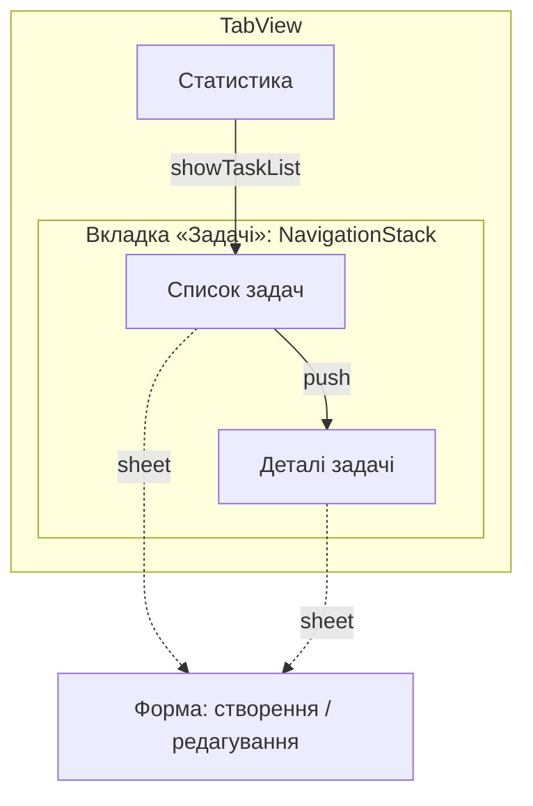

# TaskManager

Навчальний iOS-застосунок для планування задач (SwiftUI, архітектура MVVM).
Розвивається послідовно в практичних роботах; кожна здається окремим тегом.

| Робота | Тема | Тег |
|---|---|---|
| 1 | Основа проєкту, Git, базові конструкції Swift | `practical-1` |
| 2 | Архітектура (MVVM), патерни проєктування, SOLID | `practical-2` |
| 3 | Навігація: Router, push / modal, анімація | `practical-3` |

## Предметна область

Застосунок для персонального планування задач. Користувач створює задачі з
пріоритетом і необов'язковим дедлайном, позначає їх виконаними, сортує й фільтрує
список. Дані зберігаються між запусками.

Сутності:
- **TaskItem** — окрема задача: назва, пріоритет, необов'язковий дедлайн, статус виконання, нотатки.
- **TaskList** — іменований список задач: додавання, редагування, видалення, позначення виконаною, вибірка невиконаних, статистика.
- **TaskDraft** — чернетка задачі у формі редагування (копія полів, яку можна скасувати).

> Названо `TaskItem`, а не `Task`, щоб не конфліктувати з вбудованим типом Swift Concurrency `Task` (async/await).

## Технічні вимоги

- Xcode: 26.6
- Мінімальна підтримувана версія iOS: 26.5 (iPhone та iPad)
- Мова: Swift, інтерфейс — SwiftUI
- Bundle Identifier: `kpi.ios.vybirka.TaskManager`

## Підготовка проєкту

Додаткових залежностей (SPM, CocoaPods) і секретів немає — достатньо клонувати
репозиторій і відкрити `TaskManager.xcodeproj` в Xcode 26.6 або новішому.
Якщо у вас інший Apple ID, у налаштуваннях таргета TaskManager → Signing & Capabilities
оберіть свою Team, щоб запускати на пристрої (для симулятора це не потрібно).

## Запуск проєкту

1. Відкрити `TaskManager.xcodeproj` в Xcode.
2. Обрати симулятор iPhone у верхній панелі.
3. Натиснути ⌘R (Run).

Сценарій для перевірки (навігація, лаба 3): вкладка «Задачі» → «+» → заповнити форму →
«Зберегти» → тап по задачі (деталі) → «Змінити» → «Зберегти» → назад до списку →
вкладка «Статистика». Детальні кроки — у [docs/NAVIGATION.md](docs/NAVIGATION.md).

**Демо-режим.** Edit Scheme → Run → Arguments → Arguments Passed On Launch → додати
`-demo`. Застосунок стартує з готовими задачами в пам'яті, без запису в `UserDefaults`.
Це демонструє заміну залежності без змін у ViewModel (див. `docs/ARCHITECTURE.md`).

## Тести

Тести лежать у `TaskManagerTests/` (Swift Testing) і перевіряють логіку та навігацію без UI
та без реального сховища (`AppRouterTests` — переходи, `TaskListViewModelTests` — дані). Щоб запустити їх, потрібен тестовий таргет:

1. File → New → Target… → **Unit Testing Bundle**, назва `TaskManagerTests`, Testing System — Swift Testing.
2. Якщо Xcode створив шаблонний файл `TaskManagerTests.swift`, його можна видалити.
3. Переконатися, що файли з папки `TaskManagerTests/` входять до цього таргета (File Inspector → Target Membership).
4. ⌘U (Product → Test).

## Архітектура (практична робота 2)

Обрано **MVVM**: `ContentView` (View) ↔ `TaskListViewModel` (ViewModel) ↔ `TaskList`,
`TaskItem` (Model) та `TaskRepository` (доступ до даних). Повний опис, схеми
компонентів, обґрунтування вибору, обмеження, пояснення SOLID, перелік виправлених
антипатернів і таблиця «патерн / принцип — компонент — призначення» —
у **[docs/ARCHITECTURE.md](docs/ARCHITECTURE.md)**.

```
TaskManager/
├── TaskManagerApp.swift       — точка входу, власник ViewModel і Router
├── ContentView.swift          — корінь навігації: TabView, NavigationStack, sheet
├── App/AppEnvironment.swift   — composition root (вибір реалізацій залежностей)
├── Navigation/AppRouter.swift — Router: вкладка, стек, модальне вікно
├── Views/                     — екрани: список, деталі, редактор, статистика
│   └── Components/            — CompletionCheckbox, TaskRowView, Motion, Priority+Color
├── ViewModels/                — TaskListViewModel, SortOption
├── Models/                    — TaskItem, Priority, TaskList, TaskDraft, TaskStatistics
├── Builders/                  — TaskItemBuilder (Builder)
├── Strategies/                — TaskSortStrategy + 3 реалізації (Strategy)
└── Repositories/              — TaskRepository, UserDefaultsTaskRepository (Adapter), InMemoryTaskRepository
```

### Патерни

| Категорія | Патерн | Компонент | Призначення |
|---|---|---|---|
| Породжувальний | Builder | `TaskItemBuilder` | покрокове створення й валідація задачі |
| Структурний | Adapter | `UserDefaultsTaskRepository` | привести `UserDefaults` до інтерфейсу `TaskRepository` |
| Поведінковий | Strategy | `TaskSortStrategy` та реалізації | взаємозамінні способи сортування |

### Єдиний сценарій через компоненти

«Додати задачу»: `TaskEditorScreen` → `TaskListViewModel.create` → `TaskItemBuilder.build` →
`TaskList.add` → `TaskRepository.saveTasks` → `refresh()` (фільтр + Strategy) →
`@Published tasks` → усі екрани оновлюються. Діаграма послідовності — в
`docs/ARCHITECTURE.md`.

## Навігація (практична робота 3)

Зв'язний сценарій із чотирьох екранів: **список → деталі (push) → форма створення /
редагування (sheet)** + вкладка **«Статистика»**. Навігацією керує окремий `AppRouter`
(`NavigationStack` зі шляхом `[TaskRoute]`, модальне вікно `TaskModal`, вкладки `AppTab`);
екрани лише просять роутер про перехід, а між собою передають тільки `id` задачі.
Дані — в єдиному `TaskListViewModel`, тому після створення чи редагування списки, деталі
й статистика оновлюються самі.

Анімація (прив'язана до стану): анімований чекбокс «виконано» (`replace` + `bounce`),
розгортання нотаток на екрані деталей, анімований прогрес у статистиці; за «Зменшити рух»
вимикається.

### Карта навігації



Повна карта, діаграма передавання даних, таблиця перевірок інтерфейсу та відповіді на
питання для захисту — у **[docs/NAVIGATION.md](docs/NAVIGATION.md)**.

### Короткий сценарій

1. Запустити (⌘R), за потреби з аргументом `-demo`.
2. «+» → ввести назву, пріоритет, дедлайн, нотатки → «Зберегти».
3. Тап по задачі → «Показати нотатки» → «Змінити» → змінити назву → «Зберегти».
4. Повернутися назад — список оновлено. Тап по чекбоксу — анімація статусу.
5. Вкладка «Статистика» — підсумки; «Відкрити список задач» повертає на список.

### Скріншоти

Зроблено в симуляторі Xcode (демо-режим `-demo`) на трьох пристроях.

| Файл | Пристрій | Що показує |
|---|---|---|
| [`01-list-iphone-air.png`](docs/screenshots/01-list-iphone-air.png) | iPhone Air | список задач: виконана, прострочена, звичайні |
| [`02-detail-iphone-air.png`](docs/screenshots/02-detail-iphone-air.png) | iPhone Air | деталі задачі, нотатки розгорнуто |
| [`03-editor-iphone-air.png`](docs/screenshots/03-editor-iphone-air.png) | iPhone Air | редагування з клавіатурою, поле нотаток видно |
| [`04-statistics-iphone-air.png`](docs/screenshots/04-statistics-iphone-air.png) | iPhone Air | вкладка «Статистика» |
| `05-list-small-iphone-large-text-1/2/3.png` ([1](docs/screenshots/05-list-small-iphone-large-text-1.png), [2](docs/screenshots/05-list-small-iphone-large-text-2.png), [3](docs/screenshots/05-list-small-iphone-large-text-3.png)) | iPhone SE | список на найбільшому Dynamic Type (Accessibility 5), три позиції прокрутки: текст переноситься й не накладається |
| [`06-editor-small-iphone-keyboard.png`](docs/screenshots/06-editor-small-iphone-keyboard.png) | iPhone SE | форма з клавіатурою: поле нотаток і кнопки не перекриті |
| [`07-list-ipad.png`](docs/screenshots/07-list-ipad.png) | iPad 13" | список на планшеті |
| [`08-editor-ipad.png`](docs/screenshots/08-editor-ipad.png) | iPad 13" | форма створення як sheet, «Зберегти» вимкнена до введення назви |

## Де в коді базові конструкції Swift (практична робота 1)

| Конструкція | Де |
|---|---|
| `struct` | `TaskItem`, `TaskItemBuilder`, стратегії сортування — семантика значення |
| `class` | `TaskList`, `TaskListViewModel`, `AppRouter`, репозиторії — семантика посилання |
| `protocol` | `Describable`, `TaskRepository`, `TaskSortStrategy` |
| `enum` | `Priority`, `SortOption`, `TaskItemBuilderError`, `TaskRoute`, `TaskModal` |
| `var` / `let` | властивості моделей, локальні змінні |
| властивості, методи, ініціалізація | `TaskItem.init`, `TaskList.add/toggleDone`, обчислювані `completedCount`, `titles` |
| колекція | `[TaskItem]` у `TaskList.tasks` |
| optional + безпечне розгортання | `TaskItem.dueDate: Date?` — `if let` у `TaskItem.describe()` та `TaskListViewModel.draft(for:)`, `guard let` у `TaskList.toggleDone` |
| умовна конструкція | `if/else`, `switch` у `Priority`, `TaskItem.describe()`, `DueDateSortStrategy` |
| обробка колекції | `filter` (`TaskList.pendingTasks`), `map` (`TaskList.titles`), `sorted` (стратегії) |

Початкова версія для лаби 1 лежить за тегом `practical-1` (`git checkout practical-1`).

## Git

`.gitignore` виключає користувацькі файли Xcode (`xcuserdata/`), кеші збірки
(`DerivedData/`, `build/`, `.build/`) та системні файли macOS (`.DS_Store`) —
під контролем версій залишаються лише файли проєкту, потрібні для збірки.

Коміти практичної роботи 2: MVVM-каркас → патерни (Builder, Adapter, Strategy) →
документація, тести, README.

Коміти практичної роботи 3: код (модель, ViewModel, Router, екрани, анімація) і тести →
документація (`docs/NAVIGATION.md`), README, скріншоти. Тег: `practical-3`.
