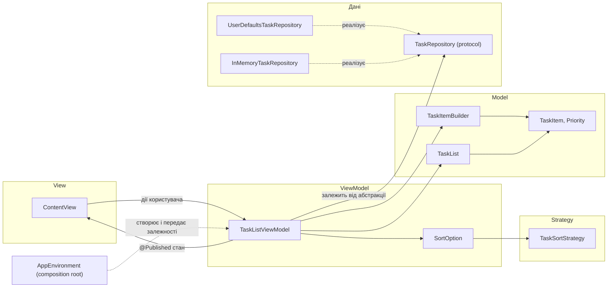
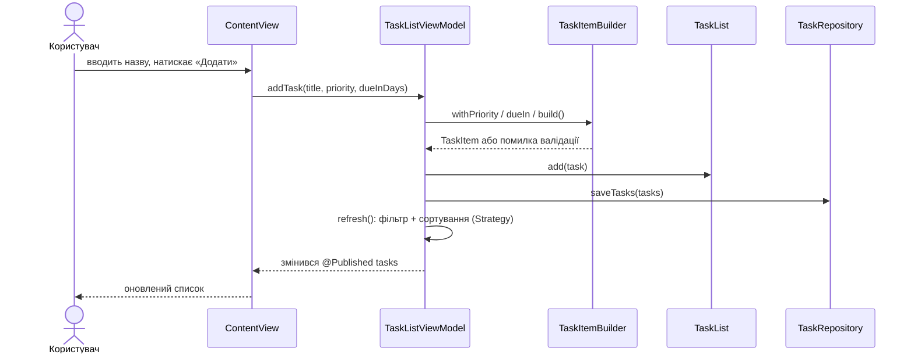

# Архітектура TaskManager (практична робота 2)

Документ описує, як розподілено відповідальність у застосунку, які патерни
проєктування й принципи SOLID застосовано та де саме вони у коді.

## 1. Аналіз сценаріїв і компонентів

Основні сценарії: переглянути список задач, додати задачу (з пріоритетом і
необов'язковим дедлайном), позначити задачу виконаною, змінити сортування,
показати лише невиконані, зберегти стан між запусками.

| Відповідальність | Компоненти | Файли |
|---|---|---|
| Представлення | `ContentView` — форма, список, перемикачі | `ContentView.swift` |
| Логіка екрана (презентаційна) | `TaskListViewModel`, `SortOption` | `ViewModels/` |
| Доменна логіка | `TaskList`, `TaskItem`, `Priority` | `Models/` |
| Створення та валідація задач | `TaskItemBuilder` | `Builders/` |
| Правила впорядкування | `TaskSortStrategy` та 3 реалізації | `Strategies/` |
| Доступ до даних | `TaskRepository` + `UserDefaultsTaskRepository`, `InMemoryTaskRepository` | `Repositories/` |
| Збирання компонентів | `AppEnvironment`, `TaskManagerApp` | `App/`, `TaskManagerApp.swift` |

## 2. Обрана архітектура: MVVM

**Model** — `TaskItem`, `TaskList`, `Priority`: дані та бізнес-правила, нічого не
знають про SwiftUI і про сховище.
**View** — `ContentView`: лише відображає стан і передає події; не створює
моделей, не звертається до сховища.
**ViewModel** — `TaskListViewModel`: тримає стан екрана (`@Published`), приймає
команди від View, координує Model, Builder, Strategy і Repository.

### Чому саме MVVM

- SwiftUI побудований на декларативному зв'язуванні «стан → екран»: `@Published` у
  `ObservableObject` дає це «з коробки», тож ViewModel природно лягає на фреймворк.
- Проєкт малий: один екран і один основний сценарій. MVC у SwiftUI не має класичного
  Controller, а логіка «розтікається» у View; VIPER (Interactor, Presenter, Router,
  Entity, View) додав би багато шарів без користі для одного екрана.
- ViewModel не залежить від UI-віджетів, тому її логіку можна тестувати без екрана
  (див. розділ 8).

### Обмеження MVVM у цьому проєкті

- Зі зростанням кількості екранів ViewModel може розростися. Тоді логіку треба
  виносити в окремі сервіси/use case-об'єкти.
- Навігації між екранами поки немає. З появою кількох екранів знадобиться окремий
  механізм (координатор/router), якого MVVM сам по собі не дає.
- Зв'язування стану прихованими оновленнями (`@Published`) ускладнює налагодження
  порівняно з явними викликами.

## 3. Схема компонентів

### Сценарій «Додати задачу»

## 4. Архітектура та патерн проєктування

Архітектура визначає **великий розподіл системи на шари** і напрямки залежностей
(тут: View → ViewModel → Model/Repository), вона одна на весь застосунок.
Патерн проєктування розв'язує **локальну повторювану задачу** в межах кількох
класів (створити об'єкт, адаптувати інтерфейс, замінити алгоритм). Патернів у
застосунку багато, і вони живуть усередині шарів архітектури.

## 5. Патерни проєктування

| Патерн | Категорія | Задача | Учасники | Де використано |
|---|---|---|---|---|
| **Builder** | Породжувальний | Створювати `TaskItem` покроково й гарантувати валідність (назва не порожня й не задовга) | Product: `TaskItem`; Builder: `TaskItemBuilder`; Director: `TaskListViewModel`, `AppEnvironment` | `ViewModel.addTask`, `AppEnvironment.demoTasks` |
| **Adapter** | Структурний | Застосунок очікує `TaskRepository` (`[TaskItem]`), а `UserDefaults` працює з `Data` за ключем | Target: `TaskRepository`; Adaptee: `UserDefaults` + `JSONEncoder/Decoder`; Adapter: `UserDefaultsTaskRepository`; Client: `TaskListViewModel` | `AppEnvironment.makeLiveViewModel` |
| **Strategy** | Поведінковий | Змінювати спосіб сортування під час роботи без розгалужень у ViewModel | Strategy: `TaskSortStrategy`; Concrete: `PrioritySortStrategy`, `DueDateSortStrategy`, `TitleSortStrategy`; Context: `TaskListViewModel` | `ViewModel.refresh` |

Додатково (платформний патерн): `@Published` + `ObservableObject` — це **Observer**:
View підписується на зміни стану ViewModel і перемальовується автоматично.

## 6. Принципи SOLID

**S — Single Responsibility.** Кожен клас має одну причину змінюватися:
`TaskList` — правила списку, `TaskListViewModel` — стан екрана, `TaskRepository` —
зберігання, `TaskItemBuilder` — створення і валідація, `TaskSortStrategy` —
порядок. `ContentView` лише малює.

**O — Open/Closed.** Новий спосіб сортування — це новий тип-стратегія; нове
сховище — новий тип, що реалізує `TaskRepository`. Код `TaskListViewModel` не
змінюється. Єдина точка розширення, яку потрібно дописати вручну, —
один `case` у `SortOption`.

**L — Liskov Substitution.** `InMemoryTaskRepository` і `UserDefaultsTaskRepository`
взаємозамінні: після `saveTasks(x)` обидва повертають `x` у `loadTasks()`. Це
перевіряє один і той самий контрактний тест для обох реалізацій.

**I — Interface Segregation.** Протоколи малі: `TaskRepository` має 2 методи,
`TaskSortStrategy` — 2 члени, `Describable` — 1. View не бачить ні репозиторій,
ні `TaskList`, лише ViewModel.

**D — Dependency Inversion.** `TaskListViewModel` залежить від абстракцій
(`any TaskRepository` і функція `now: () -> Date`), а не від `UserDefaults` чи
`Date()`. Конкретні реалізації обирає `AppEnvironment`.

### Dependency Injection і Dependency Inversion

**Dependency Inversion** — принцип про *напрямок* залежностей: і високорівневий
код (ViewModel), і низькорівневий (UserDefaults) залежать від абстракції
(`TaskRepository`), яку визначає високий рівень. **Dependency Injection** — техніка
*доставки* залежності: об'єкт отримує її ззовні (тут — через `init`), а не створює
сам. Можна мати DI без DIP (передати конкретний клас) і DIP без DI (шукати
реалізацію через service locator). У проєкті застосовано обоє.

### Заміна залежності без переписування коду

- Запуск з аргументом `-demo` (Edit Scheme → Run → Arguments Passed On Launch)
  підставляє `InMemoryTaskRepository` з готовими задачами. `TaskListViewModel` та
  `ContentView` лишаються без змін; змінюється лише рядок у `AppEnvironment`.
- У `#Preview` використано `AppEnvironment.makeDemoViewModel()`.
- У тестах підставляються `InMemoryTaskRepository`, ізольований `UserDefaults`
  (`UserDefaults(suiteName:)`) та фіксований годинник.

## 7. Перевірка на антипатерни

| Проблема | Де була (лаба 1 / перший коміт лаби 2) | Як виправлено |
|---|---|---|
| Надмірна відповідальність класу | `ContentView` одночасно малював екран, створював `TaskList`, наповнював його і друкував у консоль (`runDemoScenario`) | Розділено на View, ViewModel, Repository, Builder, Strategy |
| Пряме поєднання UI з даними | View напряму володіла моделлю й мутувала її | View бачить лише ViewModel; доступ до даних тільки через `TaskRepository` |
| Модель змішана з презентацією | `TaskList` був `ObservableObject` з `@Published` | `TaskList` став чистою моделлю; публікацію стану перейняла ViewModel |
| Приховані глобальні залежності | `Date()` у сценарії; `UserDefaults.standard` у типовому використанні | Усе «глобальне» читається лише в `AppEnvironment` і передається явно (`now`, `defaults`, `key`) |
| Дублювання/розкидані правила | Сортування за пріоритетом було зашите в `TaskList.pendingTasks` (лаба 1), а в першому коміті лаби 2 — у `ViewModel.refresh`; перевірка порожньої назви жила у ViewModel | Сортування — у стратегіях, валідація — в одному місці (`TaskItemBuilder.build`) |

### Що залишилось (свідомо)

- `TaskItem.describe()` і `Priority.displayName` містять рядки для екрана, тобто
  частину презентаційної логіки в моделі. Це залишок вимоги лаби 1 (протокол
  `Describable`). Для локалізації їх варто винести у ViewModel або форматер.
- `DateFormatter` створюється при кожному виклику `describe()`: не критично для
  такого обсягу даних, але потенційна оптимізація.
- `SortOption` потребує нового `case` для нової стратегії.

## 8. Як перевірити бізнес-логіку окремо від UI та реального сховища

Тести лежать у `TaskManagerTests/` (Swift Testing). ViewModel створюється з
`InMemoryTaskRepository` і фіксованим годинником, тому тестам не потрібні екран,
симулятор чи реальний `UserDefaults` застосунку:

- `TaskItemBuilderTests` — валідація назви, дедлайн від переданого часу;
- `SortStrategyTests` — порядок для кожної стратегії, включно з `nil`-дедлайнами;
- `RepositoryTests` — контракт «save → load» для обох реалізацій, пошкоджені дані,
  невідомий пріоритет;
- `TaskListViewModelTests` — додавання, перемикання, фільтр, сортування, помилки
  сховища (через підроблений репозиторій, що завжди падає).

Як додати тестовий таргет, описано в README.

## 9. Відповідність «патерн / принцип — компонент — призначення»

| Патерн / принцип | Компонент | Призначення |
|---|---|---|
| MVVM | `ContentView` / `TaskListViewModel` / `TaskList`, `TaskItem` | Розділення відображення, стану екрана і доменної логіки |
| Builder | `TaskItemBuilder` | Покрокове створення та валідація задачі |
| Adapter | `UserDefaultsTaskRepository` | Привести `UserDefaults` до інтерфейсу `TaskRepository` |
| Strategy | `TaskSortStrategy`, `PrioritySortStrategy`, `DueDateSortStrategy`, `TitleSortStrategy` | Взаємозамінні способи сортування |
| Observer (платформний) | `@Published` у `TaskListViewModel` | Автоматичне оновлення View |
| S (SRP) | `TaskList`, `TaskListViewModel`, `TaskRepository`, `TaskItemBuilder`, стратегії | Одна причина для змін на компонент |
| O (OCP) | `TaskSortStrategy`, `TaskRepository` | Додавання сортувань і сховищ без змін ViewModel |
| L (LSP) | `InMemoryTaskRepository`, `UserDefaultsTaskRepository` | Взаємозамінність за контрактом save → load |
| I (ISP) | `TaskRepository`, `TaskSortStrategy`, `Describable` | Малі протоколи без зайвих методів |
| D (DIP) | `TaskListViewModel` → `any TaskRepository`, `now` | Залежність від абстракцій, конкретику обирає `AppEnvironment` |
| DI | `TaskListViewModel.init`, `UserDefaultsTaskRepository.init` | Залежності приходять ззовні |
| Composition root | `AppEnvironment` | Єдине місце вибору реалізацій і читання глобальних джерел |
