# Навігація TaskManager (практична робота 3)

Документ описує зв'язний сценарій із кількох екранів: карту навігації, роль
`AppRouter`, передавання даних між екранами, оновлення списків після змін,
анімацію та перелік перевірок інтерфейсу.

## 1. Сценарій і екрани

**Сценарій:** користувач відкриває список задач → створює нову задачу (форма у
модальному вікні) → відкриває її деталі → редагує → повертається до списку й бачить
зміни → дивиться підсумки у вкладці «Статистика».

| # | Екран | Файл | Як відкривається | Що робить |
|---|---|---|---|---|
| 1 | Список задач | `Views/TaskListScreen.swift` | корінь стеку вкладки «Задачі» | перегляд, сортування, фільтр, зміна статусу, видалення свайпом |
| 2 | Деталі задачі | `Views/TaskDetailScreen.swift` | **push** зі списку | повна інформація, нотатки, що розгортаються, видалення |
| 3 | Створення / редагування | `Views/TaskEditorScreen.swift` | **модально** (sheet) зі списку або з деталей | форма з валідацією |
| 4 | Статистика | `Views/StatisticsScreen.swift` | друга вкладка `TabView` | підсумки; кнопка переходу до списку |

## 2. Карта навігації

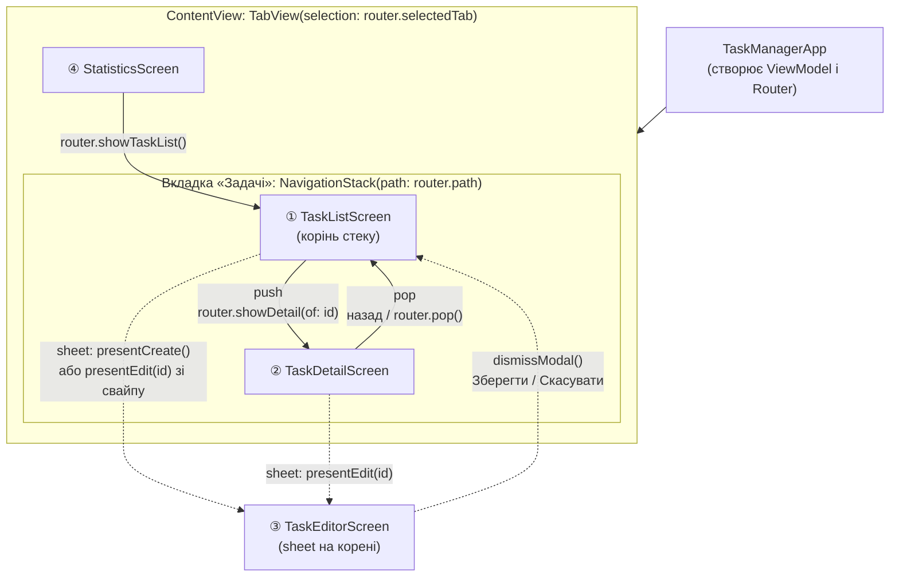

Суцільна стрілка — push у стеку, пунктирна — модальне вікно. Модальне вікно прикріплене
до кореня (`ContentView`), тому його можна відкрити з будь-якого екрана стеку, а після
закриття користувач повертається саме туди, звідки прийшов.

## 3. Роль Router

`Navigation/AppRouter.swift` — єдине місце, що зберігає *де зараз користувач*:

| Стан | Тип | Призначення |
|---|---|---|
| `selectedTab` | `AppTab` | активна вкладка |
| `path` | `[TaskRoute]` | стек навігації вкладки «Задачі» |
| `modal` | `TaskModal?` | відкрите модальне вікно |

Команди: `showDetail(of:)`, `pop()`, `popToRoot()`, `presentCreate()`,
`presentEdit(_:)`, `dismissModal()`, `showTaskList()`, `showStatistics()`.

Розподіл відповідальності:

- **Екран** не створює інші екрани й не знає про стек — він лише викликає метод роутера.
- **Router** знає *що* відкрити, але не знає *як це виглядає* (жодного `import SwiftUI`).
- **`ContentView`** перетворює маршрут на екран: `navigationDestination(for: TaskRoute.self)`
  і `sheet(item: $router.modal)`.
- **ViewModel** відповідає за дані і нічого не знає про навігацію.

Захист від повторних тапів: `showDetail(of:)` не додає в стек ту саму задачу двічі, а
`present…` ігнорує виклик, поки вже відкрите інше модальне вікно.

## 4. Передавання даних

**Вперед:** маршрут несе лише ідентифікатор — `TaskRoute.detail(TaskItem.ID)`,
`TaskModal.edit(TaskItem.ID)`. Копія задачі не передається: екран деталей і форма
щоразу беруть актуальні дані з ViewModel (`viewModel.task(id:)`, `viewModel.draft(for:)`).
Тому не виникає двох розбіжних копій однієї задачі.

**Назад (результат редагування):** форма працює з власною копією — `TaskDraft`
(struct). Натиснули «Зберегти» → `viewModel.update(id:with:)` змінює єдине джерело
правди → `@Published tasks` → усі екрани, що спостерігають ViewModel, перемальовуються
самі. Результат не повертається замиканням чи делегатом: він «повертається» через спільний стан.
«Скасувати» просто закриває форму — оригінал не змінювався.

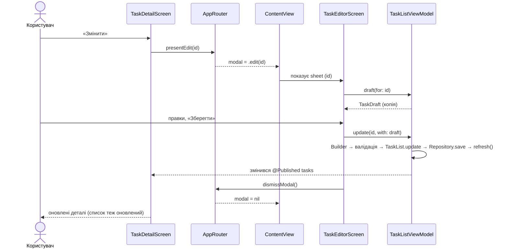

Помилка валідації (наприклад, задовга назва) показується прямо у формі, а форма
лишається відкритою; виняток `TaskEditingError.taskNotFound` — якщо задачу видалили,
поки форма була відкрита.

## 5. Де зберігається і як оновлюється UI-стан

| Стан | Де живе | Чому |
|---|---|---|
| Задачі, сортування, фільтр, помилки | `TaskListViewModel` (`@Published`) | спільні для кількох екранів |
| Вкладка, стек, модальне вікно | `AppRouter` (`@Published`) | спільні, потрібні тестам |
| Чернетка форми, помилка форми, фокус | `@State` / `@FocusState` у `TaskEditorScreen` | належать лише цій формі |
| Розгорнуті нотатки, діалог видалення | `@State` у `TaskDetailScreen` | суто візуальний стан екрана |

Власником `ViewModel` і `Router` є `TaskManagerApp` (`@StateObject`); екрани отримують їх
як `@ObservedObject` — вони не володіють цими об'єктами, а лише спостерігають.

## 6. Анімація

Реалізовано власні анімації, прив'язані до **стану**, а не лише стандартні переходи
навігації:

1. **Анімований чекбокс** (`Views/Components/CompletionCheckbox.swift`) — значок
   змінюється з ефектом `replace`, а при позначенні «підстрибує» (`symbolEffect(.bounce)`).
   Анімація залежить від `isDone`; рядок у списку при цьому плавно переміщується
   (`Motion.list`).
2. **Розгортання нотаток** на екрані деталей — стрілка повертається на 90°, текст
   з'являється з `opacity + move(edge: .top)`; прив'язано до `isNotesExpanded`.
3. **Прогрес на «Статистиці»** — відсоток змінюється з `numericText`, смужка прогресу — плавно.

Усі тривалості зведені в `Views/Components/Motion.swift` (≤ 0.35 с, без циклів).
За ввімкненого системного **«Зменшити рух»** (Reduce Motion) анімації вимикаються:
зміна стану відбувається миттєво.

**Як перевірено, що анімація не блокує взаємодію:** `allowsHitTesting` ніде не
вимикається, анімації короткі й скінченні, тап під час руху обробляється (повторний
тап просто перемикає стан знову). Перевірка вручну — у розділі 8 (швидкі тапи по
чекбоксу й по рядку під час анімації).

## 7. Як запустити сценарій

1. Відкрити проєкт, обрати симулятор (наприклад, iPhone SE і iPad) → ⌘R.
2. Для готових даних додати аргумент запуску `-demo` (Edit Scheme → Run → Arguments).
3. Крок за кроком:
   1. На вкладці «Задачі» натиснути «+» → ввести назву, обрати пріоритет, за бажанням
      дедлайн і нотатки → «Зберегти». Нова задача з'явиться у списку.
   2. Тап по задачі → відкриються деталі. Натиснути «Показати нотатки» — блок розгорнеться.
   3. «Змінити» → змінити назву → «Зберегти». Деталі оновилися; повернутися назад (кнопка
      або свайп від краю) — список теж оновлений.
   4. Тап по чекбоксу — задача виконана (анімація), рядок може змінити позицію.
   5. Свайп по рядку вліво: «Редагувати» (відкриє форму) і «Видалити».
   6. Вкладка «Статистика»: числа відповідають списку; «Відкрити список задач» повертає
      на першу вкладку.

## 8. Перевірка інтерфейсу

Перевірка виконана вручну в симуляторі на двох розмірах екрана (iPhone та iPad); усі пункти пройдені.

| Перевірка | iPhone (малий) | iPad |
|---|---|---|
| Усі 4 екрани відкриваються, переходи працюють | ☑ | ☑ |
| Довга назва задачі переноситься, не налазить на чекбокс і стрілку | ☑ | ☑ |
| Dynamic Type: великий розмір шрифту (Settings → Accessibility або Environment Overrides) — текст не накладається, рядок переноситься | ☑ | ☑ |
| Форма: клавіатура не перекриває поле нотаток (форма прокручується), кнопка «Готово» ховає клавіатуру | ☑ | ☑ |
| Форма: порожня назва → «Зберегти» вимкнена; назва > 100 символів → помилка у формі | ☑ | ☑ |
| Повторні переходи (список → деталі → назад) ×5 без дублікатів у стеку | ☑ | ☑ |
| Швидкі повторні тапи по рядку / по «+» не відкривають два екрани/вікна | ☑ | ☑ |
| Після створення й редагування списки, деталі й статистика оновлені | ☑ | ☑ |
| Скасування форми з незбереженими змінами питає підтвердження | ☑ | ☑ |
| Анімація не блокує тапи (швидко натиснути чекбокс кілька разів) | ☑ | ☑ |
| Reduce Motion (Settings → Accessibility → Motion) — анімації вимкнено, все працює | ☑ | ☑ |
| Темна тема читається | ☑ | ☑ |

Скріншоти — нижче та в `docs/screenshots/`.

## Скріншоти

**iPhone Air** — список, деталі, редагування з клавіатурою, статистика:

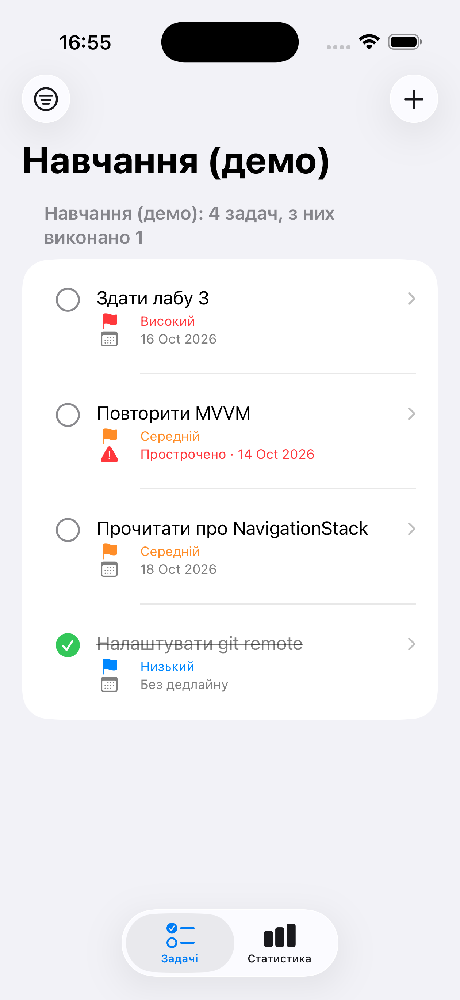
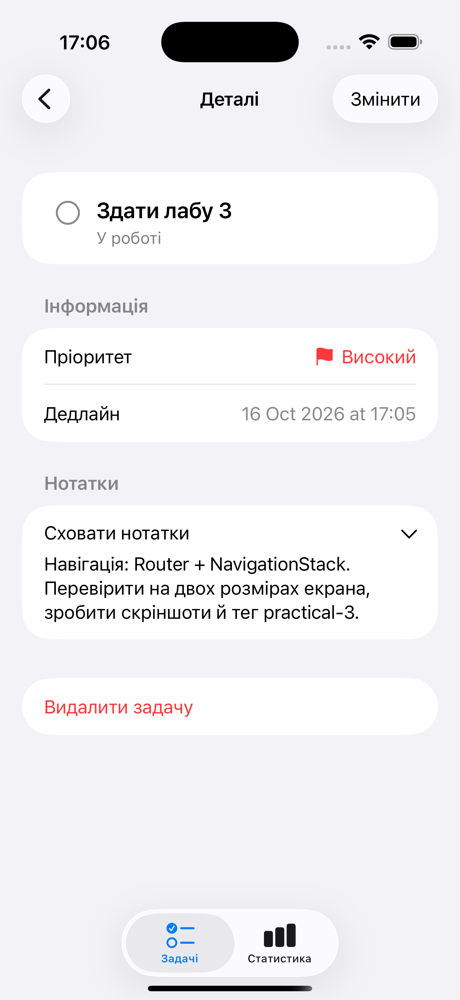
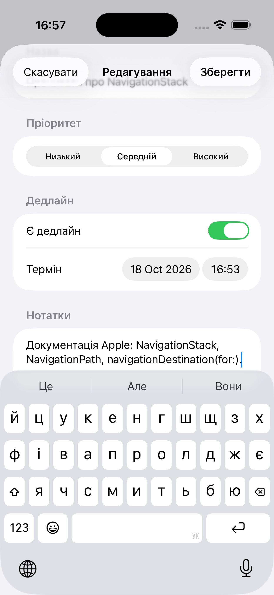
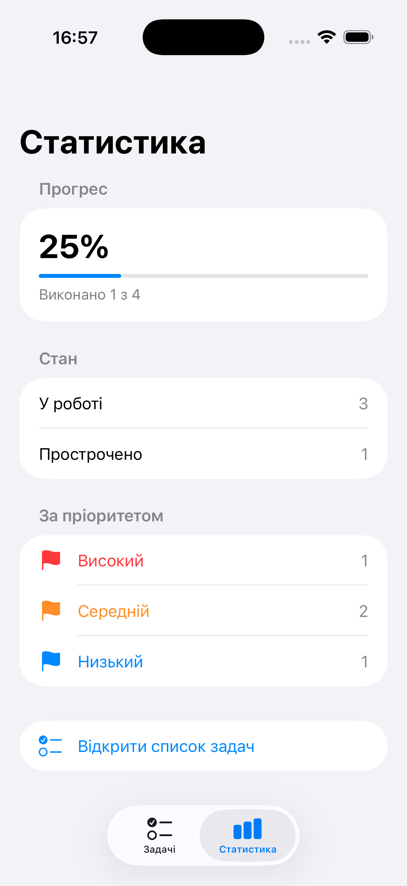

**iPhone SE, найбільший Dynamic Type** — текст переноситься, не накладається; форма з клавіатурою:

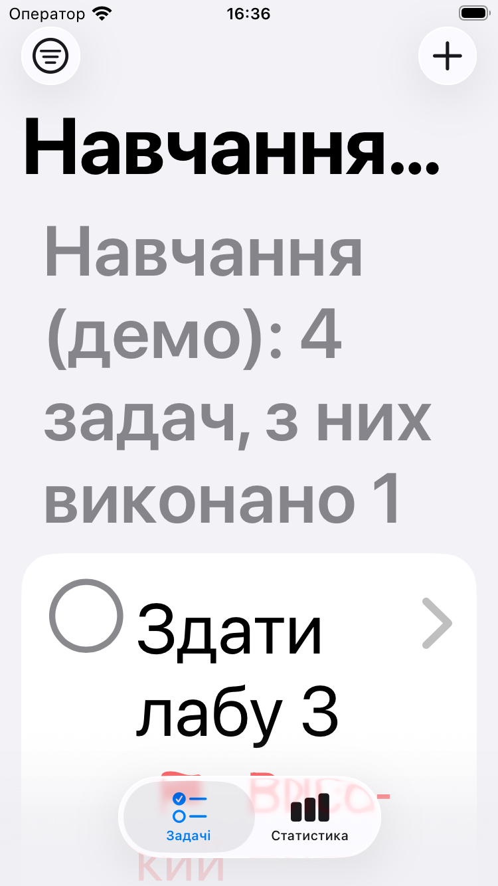
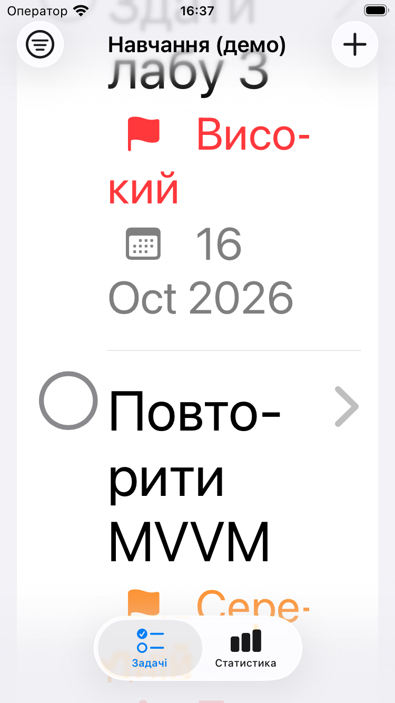
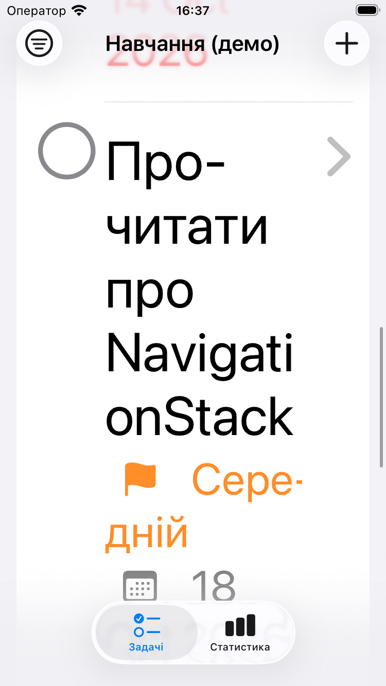
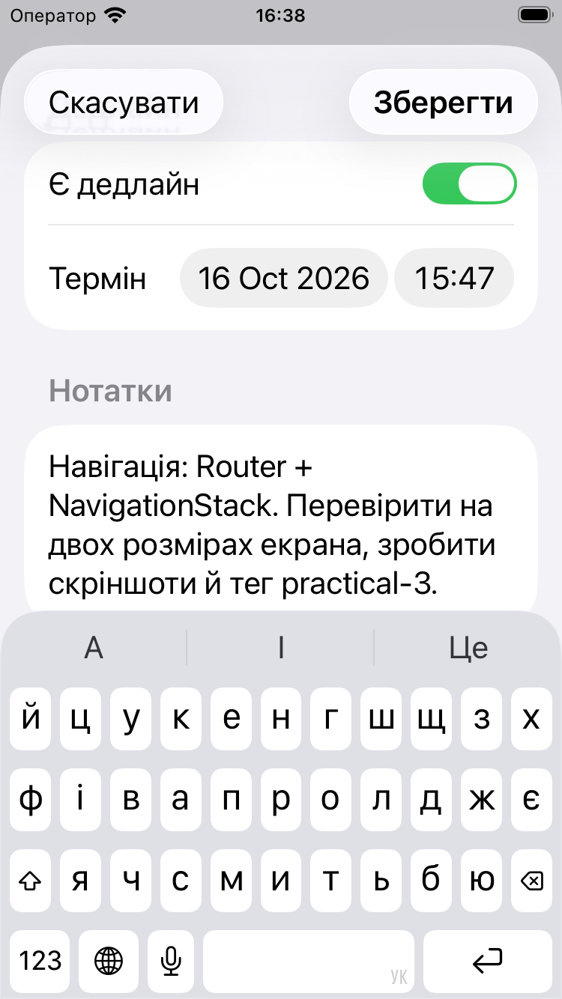

**iPad 13"**:

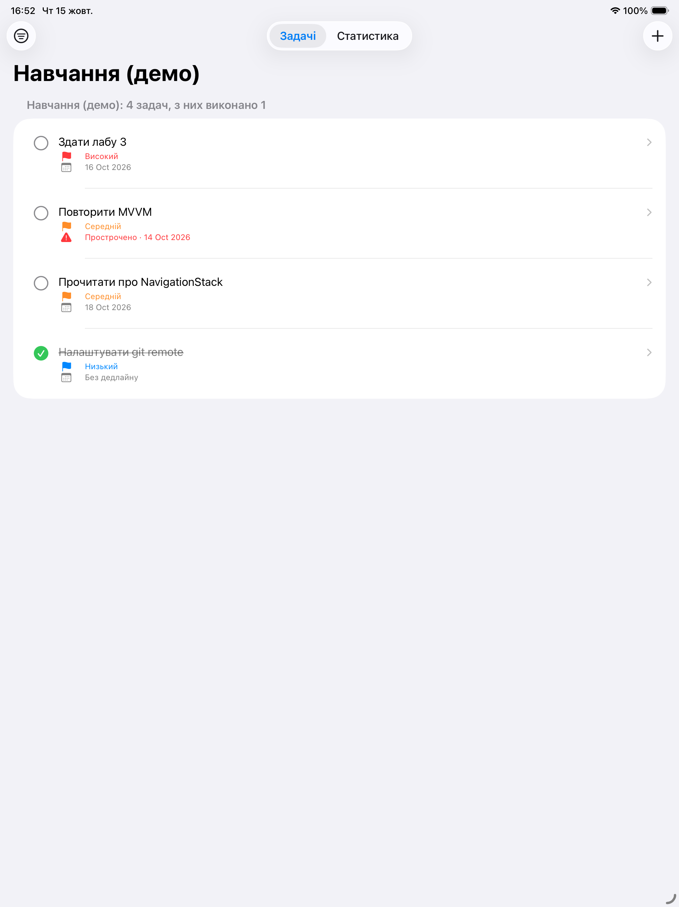
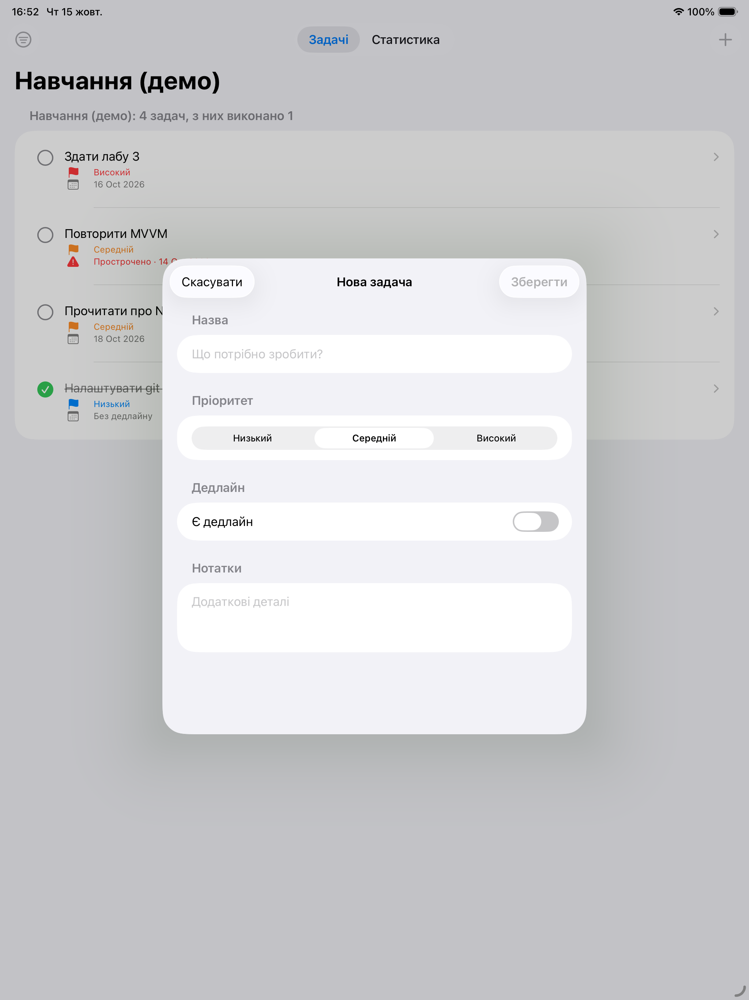

## 9. Відповіді на питання для захисту

**Яку відповідальність має Coordinator/Router і чим вона відрізняється від ViewModel?**
Router знає, де користувач зараз знаходиться й куди може піти (вкладка, стек, модальне
вікно), і змінює цей стан за командою. ViewModel відповідає за дані й бізнес-логіку екрана
(задачі, валідація, сортування). Router не знає про задачі, ViewModel не знає про
навігацію — тому кожну частину можна міняти й тестувати окремо (`AppRouterTests`).

**Коли використовувати стек (push), а коли модальну презентацію?**
Push — для переходу вглиб у межах однієї ієрархії: список → деталі; користувач бачить
кнопку «Назад» і зберігає контекст. Модальне вікно — для окремого завершеного завдання,
яке треба або підтвердити, або скасувати (форма створення/редагування): воно тимчасово
перериває основний потік і закривається явною дією.

**Як передаються дані між екранами й повертається результат редагування?**
Вперед — лише ідентифікатор у маршруті (`TaskRoute.detail(id)`, `TaskModal.edit(id)`),
а дані екран бере з ViewModel. Назад — через зміну спільного стану: форма редагує копію
(`TaskDraft`), а «Зберегти» викликає `viewModel.update`, після чого всі екрани оновлюються
автоматично (`@Published`).

**Де зберігається UI-стан і як він оновлюється?**
Спільний стан — у `TaskListViewModel` та `AppRouter` (`@Published`), локальний стан екрана —
в `@State`/`@FocusState`. SwiftUI перемальовує View, коли змінюється значення, за яким
вона спостерігає.

**Як уникнути retain cycles у навігаційних компонентах?**
Ланцюжок власності односпрямований: App → ViewModel/Router → екрани (екрани отримують їх як
`@ObservedObject`, але не зберігають у власних замиканнях). Router не посилається ні на
екрани, ні на ViewModel і не приймає замикань; кнопки викликають методи роутера напряму.
Якби замикання зберігалося в довгоживучому об'єкті (наприклад, `onFinish` у Coordinator),
у ньому використовували б `[weak self]` або `weak`-посилання на батьківський координатор.

**Як перевірити, що анімація не блокує взаємодію?**
Анімації короткі (≤ 0.35 с) і скінченні, `allowsHitTesting(false)` не застосовується,
анімація прив'язана до зміни стану, тож повторний тап одразу змінює стан знову. Перевіряється
вручну швидкими тапами під час руху (розділ 8), а також при вимкненому русі (Reduce Motion).
