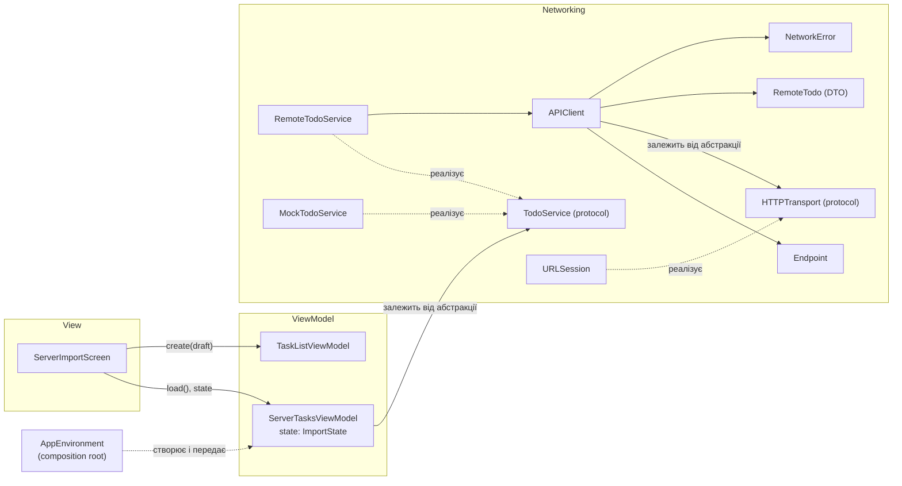
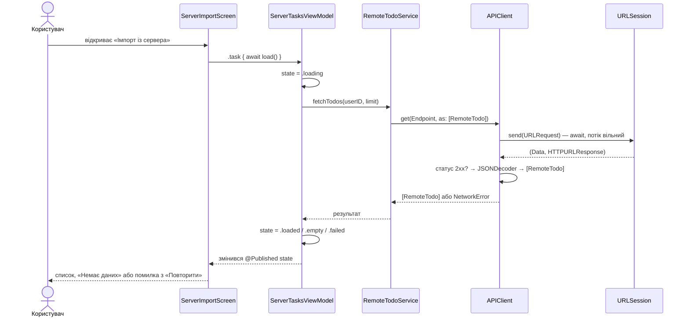
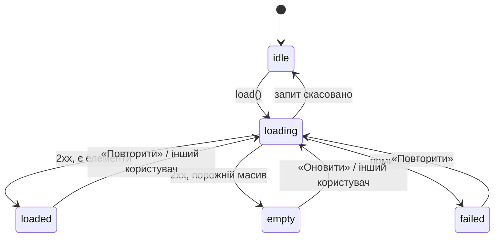

# Мережевий шар TaskManager (практична робота 4)

Мета: підключити серверне джерело даних, винести роботу з мережею в окремий шар
і показати результат та помилки в інтерфейсі. Сценарій у застосунку — екран
**«Імпорт із сервера»**: завантажити список задач із сервера й додати потрібні в локальний список.

## 1. Джерело даних: JSONPlaceholder

Відкритий тестовий REST API, без реєстрації й ключів.

| Параметр | Значення |
|---|---|
| Базова адреса (base URL) | `https://jsonplaceholder.typicode.com` |
| Endpoint | `GET /todos` |
| Параметри (query) | `userId` — задачі конкретного користувача (1…10); `_limit` — максимальна кількість елементів (у застосунку 20) |
| Приклад запиту | `GET https://jsonplaceholder.typicode.com/todos?userId=1&_limit=20` |
| Заголовки запиту | `Accept: application/json` |
| Тіло запиту | немає (GET) |
| Авторизація | не потрібна |
| Формат відповіді | JSON-масив об'єктів |
| Успішний статус | `200 OK` |
| Ліміти | офіційних немає; сервіс публічний, тому можливі короткочасні збої |

Приклад відповіді:

```json
[
  { "userId": 1, "id": 1, "title": "delectus aut autem", "completed": false },
  { "userId": 1, "id": 2, "title": "quis ut nam facilis et officia qui", "completed": false }
]
```

Відповідність полів:

| Поле JSON | Тип | У моделі `RemoteTodo` | Використання |
|---|---|---|---|
| `userId` | число | `userID` (через `CodingKeys`) | чий це список |
| `id` | число | `id` | номер на сервері (показується в рядку, пишеться в нотатки) |
| `title` | рядок | `title` | назва майбутньої задачі |
| `completed` | булеве | `completed` | імпортується як виконана / невиконана |

### Структура HTTP-запиту

Будь-який HTTP-запит складається з чотирьох частин; усі вони описані в `Endpoint`:

1. **Метод** — що зробити: `GET` читає, `POST` створює, `PUT`/`PATCH` змінюють, `DELETE` видаляє.
2. **URL** — адреса ресурсу: схема + хост + шлях (`/todos`) + параметри рядка запиту (`?userId=1&_limit=20`).
3. **Заголовки** — метадані: що ми приймаємо (`Accept`), у якому форматі надсилаємо тіло (`Content-Type`), хто ми (`Authorization`).
4. **Тіло** — дані, які передаються серверу (у GET його немає).

Реальний запит застосунку на мережевому рівні:

```
GET /todos?userId=1&_limit=20 HTTP/1.1
Host: jsonplaceholder.typicode.com
Accept: application/json
```

## 2. Архітектура мережевого шару



| Компонент | Відповідальність |
|---|---|
| `Endpoint`, `HTTPMethod` | Опис запиту як даних (метод, шлях, query, заголовки, тіло) і збирання `URLRequest` |
| `HTTPTransport` | Найнижчий рівень: «відправити запит → отримати байти й відповідь». Реалізація — `URLSession` |
| `APIClient` | **Єдине місце**, де виконується запит і розбирається відповідь: транспорт → перевірка HTTP-статусу → декодування |
| `NetworkError` | Єдиний тип мережевих помилок: транспорт / HTTP-статус / декодування, з повідомленням для користувача |
| `RemoteTodo` | DTO: форма даних сервера (`Decodable`), окрема від доменної моделі `TaskItem` |
| `TodoService` | Протокол «дай задачі користувача». Те, що бачить ViewModel |
| `RemoteTodoService` | Реальна реалізація поверх `APIClient` |
| `MockTodoService` | Керована заглушка: порожня відповідь, помилки, «збій, потім успіх», затримка |
| `ServerTasksViewModel` | Стан екрана (`ImportState`), запуск завантаження |
| `ServerImportScreen` | Малює стан, нічого не знає про мережу |
| `AppEnvironment` | Вибір реалізації сервісу (реальна чи mock за аргументом запуску) |

Мережеві виклики **не розкидані по екранах**: у `Views/` немає жодного `URLSession`, `URL` чи JSON.

### Як мережевий шар вбудований в архітектуру

- **Доступ через протокол.** ViewModel має `any TodoService`, а `APIClient` — `any HTTPTransport`.
- **Залежність передається ззовні (DI).** `ServerTasksViewModel(service:)` отримує сервіс в `init`;
  конкретну реалізацію обирає `AppEnvironment.makeTodoService(arguments:)` — той самий composition root, що й для сховища.
- **UI отримує стан через компоненти архітектури.** `@Published private(set) var state: ImportState` у ViewModel;
  екран робить `switch viewModel.state`. Невалідні комбінації («завантаження і помилка одночасно») неможливі, бо стан — це `enum`.
- **Оновлення UI на головному акторі.** Проєкт зібрано з `SWIFT_DEFAULT_ACTOR_ISOLATION = MainActor`:
  ViewModel і екрани виконуються на головному потоці, тому присвоєння `state` після `await` завжди відбувається на main.
  Ручний `DispatchQueue.main.async` не потрібен (див. розділ 6).
- **Імпорт у домен** іде через існуючий `TaskListViewModel.create(_:isDone:)` → Builder → Repository, тобто серверні дані
  проходять ту саму валідацію, що й введені вручну.

### Потік даних



## 3. Стани екрана



| Стан | Що бачить користувач | Як відтворити |
|---|---|---|
| `loading` | індикатор і текст «Завантаження…» | `-network-slow` (затримка 3 с) |
| `loaded` | список серверних задач, кнопки «Додати до списку» / «Додати всі нові» | без аргументів (реальний запит) |
| `empty` | «Немає даних» + кнопка «Оновити» | `-network-empty` |
| `failed` | значок, зрозуміле повідомлення, кнопка «Повторити» | `-network-error`, `-network-offline`, `-network-decoding` |

Одночасно можливий лише один стан. Скасований запит (закрили екран, змінили користувача) не показується як помилка.

### Скріншоти станів

| Файл | Що показує |
|---|---|
| [`09-import-loaded-iphone-air.png`](screenshots/09-import-loaded-iphone-air.png) | успіх, реальний запит: список із 20 задач сервера; перші три вже додані, нагорі «Додати всі нові (17)» |
| [`10-import-loading-iphone-air.png`](screenshots/10-import-loading-iphone-air.png) | стан «Завантаження…» (`-network-slow`) |
| [`11-import-empty-iphone-air.png`](screenshots/11-import-empty-iphone-air.png) | стан «Немає даних» + «Оновити» (`-network-empty`) |
| [`12-import-error-http-iphone-air.png`](screenshots/12-import-error-http-iphone-air.png) | HTTP-помилка 500 + «Повторити» (`-network-error`) |
| [`13-xcode-console-request.png`](screenshots/13-xcode-console-request.png) | консоль із фільтром `[Network]`: `GET …/todos?userId=1&_limit=20 -> 200, 2271 bytes` — доказ реального запиту |
| [`14-import-offline-iphone-air.png`](screenshots/14-import-offline-iphone-air.png) | транспортна помилка: немає інтернету (`-network-offline`) |
| [`15-import-decoding-iphone-air.png`](screenshots/15-import-decoding-iphone-air.png) | помилка декодування: неочікуваний формат (`-network-decoding`) |
| [`17-list-after-import-iphone-air.png`](screenshots/17-list-after-import-iphone-air.png) | основний список після імпорту: серверні задачі поруч із локальними |
| [`18-import-ipad.png`](screenshots/18-import-ipad.png) | екран імпорту як sheet на планшеті |

## 4. Класифікація помилок

`APIClient` розрізняє три принципово різні ситуації. Для користувача вони звучать по-різному,
а для розробника вказують на різні причини:

| Група | Що сталося | `NetworkError` | Приклад повідомлення |
|---|---|---|---|
| **Транспорт** | Запит не дійшов або відповідь не прийшла: немає інтернету, таймаут, не знайдено хост | `.transport(URLError.Code)` | «Немає з'єднання з інтернетом. Перевірте мережу й повторіть.» |
| **HTTP-статус** | Сервер відповів, але статус не 2xx (404, 500, 503…) | `.httpStatus(Int)` | «Сервер тимчасово недоступний (код 500). Спробуйте пізніше.» |
| **Декодування** | Статус 2xx, але тіло не відповідає моделі: інший формат, немає ключа, інший тип | `.decoding(String)` | «Сервер повернув дані в неочікуваному форматі.» |
| Інше | некоректна адреса, не-HTTP відповідь, скасування | `.invalidURL`, `.invalidResponse`, `.cancelled` | — |

Порядок обробки в `APIClient.get` фіксований:

1. відправити запит (`await transport.send`) — збій → `.transport` (а `URLError.cancelled` / `CancellationError` → `.cancelled`);
2. переконатися, що відповідь — `HTTPURLResponse`, інакше `.invalidResponse`;
3. **перевірити статус `200…299` до того, як торкатися тіла** — інакше `.httpStatus`;
4. `JSONDecoder().decode` — збій → `.decoding`.

Технічні подробиці декодування (яке поле зламалось) потрапляють у `NetworkError.decoding(String)` для логів,
але **не** в повідомлення користувачу. У DEBUG-збірці кожна відповідь друкується в консоль:
`[Network] GET https://jsonplaceholder.typicode.com/todos?userId=1&_limit=20 -> 200, 2271 bytes`.

## 5. Асинхронність: чому інтерфейс не блокується

- Завантаження стартує з `.task(id:)` на екрані: SwiftUI запускає асинхронну задачу, прив'язану до життя екрана.
- `await` **призупиняє функцію, а не потік**: поки `URLSession` чекає відповіді, головний потік вільний і малює UI
  (індикатор крутиться, кнопка «Закрити» натискається).
- Закриття екрана або зміна користувача **скасовує задачу** (структурована конкурентність); скасування доходить
  до `URLSession`, а ViewModel не перезаписує стан застарілою відповіддю (`Task.checkCancellation()`).
- Кнопка «Повторити» змінює `attempt`, який входить в ідентифікатор `.task(id:)` — SwiftUI скасовує стару
  задачу й запускає нову. Окремого коду «ручного» повтору немає.

Чесне уточнення: після `await` код ViewModel продовжується на головному акторі, тому і декодування JSON
(20 елементів — мікросекунди) виконується там же. Для великих відповідей декодування варто виносити
з головного потоку (`@concurrent` / `nonisolated` функція); тут це свідомо не робилось, щоб не ускладнювати модель ізоляції.

## 6. Як запустити й перевірити стани

### Запуск

1. Відкрити проєкт в Xcode 26.6, обрати симулятор, ⌘R (потрібен інтернет для реального запиту).
2. На екрані «Задачі» натиснути кнопку імпорту (хмаринка зі стрілкою вниз у правому верхньому куті)
   або «Імпортувати із сервера» в порожньому списку.

### Керовані стани: аргументи запуску

Edit Scheme… → Run → Arguments → **Arguments Passed On Launch** → додати **один** аргумент (решту зняти галочкою),
далі ⌘R. Аргумент підставляє `MockTodoService` замість реальної мережі (`AppEnvironment.makeTodoService`).

| Аргумент | Що відтворює | Очікуваний результат |
|---|---|---|
| *(жодного)* | реальний запит до JSONPlaceholder | список із 20 задач; у консолі Xcode рядок `[Network] GET … -> 200` |
| `-network-slow` | успіх із затримкою 3 с | кілька секунд «Завантаження…», потім список |
| `-network-empty` | сервер повернув `[]` | «Немає даних» + «Оновити» |
| `-network-error` | HTTP 500 | «Сервер тимчасово недоступний (код 500)…» + «Повторити» (помилка повторюється) |
| `-network-offline` | немає інтернету (транспорт) | «Немає з'єднання з інтернетом…» + «Повторити» |
| `-network-decoding` | 200, але невідповідний формат | «Сервер повернув дані в неочікуваному форматі.» + «Повторити» |
| `-network-flaky` | перший запит 503, наступні успішні | помилка → «Повторити» → список |

Аргументи можна поєднувати з `-demo` (демо-задачі + мережевий сценарій). Якщо вказано кілька `-network-*`,
діє перший за порядком перевірки: `-network-empty`, `-network-error`, `-network-offline`, `-network-decoding`, `-network-flaky`, `-network-slow`.

### Перевірка сценарію імпорту

1. Запуск без аргументів → відкрити імпорт → з'явився список; у консолі є рядок про запит і статус 200.
2. «Додати до списку» біля однієї задачі → кнопка замінилась на «Додано».
3. «Додати всі нові (N)» → усі решта позначені «Додано», кнопка зникла.
4. «Закрити» → у списку задач нові елементи з нотатками «Імпортовано з сервера (JSONPlaceholder, id …)».
   Задачі з `completed: true` імпортуються виконаними.
5. Повторно відкрити імпорт → уже додані задачі позначені «Додано» (дублікатів немає; порівняння за назвою без урахування регістру).
6. Меню «Користувач N» → інший користувач → новий запит і новий список.

Реальну транспортну помилку можна побачити, вимкнувши інтернет на Mac (симулятор використовує його мережу)
й відкривши екран імпорту без аргументів.

### Автоматичні тести

Запуск: ⌘U. Нові тести не потребують мережі:

| Файл | Що перевіряє |
|---|---|
| `NetworkingTests` | `Endpoint` (URL, метод, заголовки, тіло); `APIClient` із заглушкою транспорту: успіх, 404/500/304 → `.httpStatus` **раніше** за декодування, зламаний JSON / невірна форма / немає ключа / невірний тип → `.decoding`, `URLError` → `.transport`, скасування, не-HTTP відповідь; `RemoteTodoService` (параметри `userId`, `_limit`); вибір mock за аргументами |
| `ServerTasksViewModelTests` | стани `loaded`, `empty`, `failed` (HTTP / транспорт / декодування), «збій → повтор → успіх», параметри запиту, стан `loading` під час очікування, скасування без помилки |
| `ImportFromServerTests` | мапінг `RemoteTodo` → чернетка (обрізання назви, нотатки), імпорт виконаної задачі, `hasTask(titled:)` |
| `AppRouterTests` | відкриття модального вікна імпорту |

## 7. Відповіді на питання для захисту

**Структура HTTP-запиту.** Метод (що зробити), URL (хост + шлях + query-параметри), заголовки (метадані: `Accept`,
`Content-Type`, `Authorization`) і необов'язкове тіло (дані для сервера; у GET немає). У коді це `Endpoint`
(`path`, `queryItems`, `method`, `headers`, `body`), який `makeRequest(baseURL:)` перетворює на `URLRequest`.
Застосунок надсилає `GET /todos?userId=1&_limit=20` із заголовком `Accept: application/json`.

**Транспортна помилка чи HTTP-помилка.** Транспортна — запит не виконався взагалі: немає зв'язку, таймаут, DNS.
`URLSession` кидає `URLError`, відповіді немає. HTTP-помилка — зв'язок є, сервер відповів, але зі статусом не 2xx
(404 — нема ресурсу, 500 — збій сервера): `URLSession` **не** вважає це помилкою, тому статус треба перевіряти вручну.
У `APIClient` перше стає `.transport(код)`, друге — `.httpStatus(код)`; повідомлення різні («перевірте мережу»
проти «сервер недоступний»), бо й дії користувача різні.

**Як працює декодування й що буде при невідповідності формату.** `RemoteTodo: Decodable`; `JSONDecoder` зіставляє
ключі JSON з полями (`userId` → `userID` через `CodingKeys`) і перевіряє типи. Зайві поля ігноруються. Якщо ключа немає,
тип інший (`"id": "один"`), значення `null` для не-optional, або це взагалі не JSON чи не масив — кидається `DecodingError`
(`keyNotFound`, `typeMismatch`, `valueNotFound`, `dataCorrupted`). `APIClient` перехоплює її й повертає
`NetworkError.decoding`, екран показує «Сервер повернув дані в неочікуваному форматі» з кнопкою «Повторити».
Застосунок не падає й не показує напівзаповнені дані. Це перевіряють тести й аргумент `-network-decoding`.

**Як організовані асинхронність і оновлення UI.** `load()` — `async`-функція ViewModel; екран запускає її через
`.task(id:)`. `await` призупиняє виконання без блокування потоку, `URLSession` працює у своїх потоках.
ViewModel і екрани ізольовані на `MainActor`, тому після `await` присвоєння `@Published state` відбувається на головному
потоці, а SwiftUI перемальовує екран. Закриття екрана скасовує задачу, і застарілі відповіді не перезаписують стан.

**Навіщо абстракція мережевого сервісу.** (1) Залежність від протоколу, а не від `URLSession`: ViewModel не знає про HTTP
і JSON (DIP). (2) Тестованість: у тестах і в демо підставляється `MockTodoService` або заглушка транспорту.
(3) Заміну джерела (інший API, кеш, файл) можна зробити без змін ViewModel і екрана (OCP). (4) Єдина точка
для логіки запитів: статуси, помилки, логування, таймаути — в одному місці, а не в кожному екрані.

**Як перевіряти помилки без випадкових збоїв зовнішнього API.** Помилку можна **вказати** замість того, щоб чекати її:
на рівні сервісу — `MockTodoService(script: [.failure(.httpStatus(500))])`; на рівні транспорту — `StubTransport`,
який повертає потрібні байти чи `URLError`; у запущеному застосунку — аргументи `-network-*`. Сценарій «збій, потім
успіх» (`-network-flaky`) перевіряє повтор. Тести детерміновані, швидкі й працюють без інтернету.

## 8. Свідомі обмеження

- Лише `GET`: `Endpoint` уже вміє `POST`/`PUT`/`PATCH`/`DELETE`, заголовки й тіло (покрито тестом), але `APIClient` має
  тільки метод `get` — потреби в інших методах у цій роботі немає. JSONPlaceholder до того ж не зберігає записані дані.
- Кешу немає: кожне відкриття екрана робить новий запит.
- Пагінації немає: `_limit=20`.
- Авторизації немає: API публічний; заголовок `Authorization` додається через `Endpoint.headers`, якщо знадобиться.
- Повторні спроби автоматично не виконуються — тільки за дією користувача («Повторити»).
